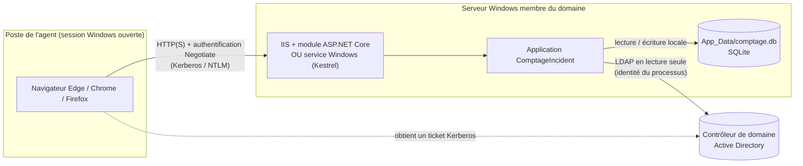
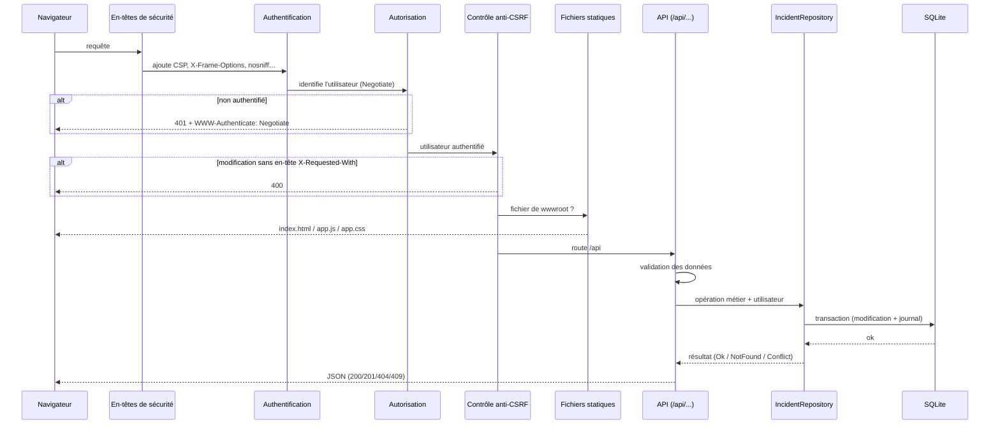

# 02 · Architecture

## Vue d'ensemble

L'application est **un seul programme** (ASP.NET Core 10) qui fournit à la fois :
- l'**interface Web** : fichiers statiques `wwwroot/`, du HTML/CSS/JS natif sans bibliothèque externe ;
- l'**API REST** sous `/api`, appelée par l'interface ;
- une **tâche de fond** qui purge la corbeille.

Elle s'appuie sur trois composants externes, tous standards Windows ou intégrés :

| Composant | Rôle | Remarque |
|---|---|---|
| Authentification Windows (SSPI) | Identifier l'utilisateur sans saisie | Fournie par IIS ou par le système, via le paquet `Microsoft.AspNetCore.Authentication.Negotiate` |
| Active Directory | Fournir les noms pour les suggestions | Lecture seule, avec l'identité du processus |
| SQLite | Stocker incidents, personnes et journal | Moteur intégré à l'application : un simple fichier, aucun serveur de base de données |

## Deux modes d'hébergement, un seul code

| | IIS | Autonome |
|---|---|---|
| Qui reçoit les requêtes HTTP | IIS (module `AspNetCoreModuleV2`, *in-process*) | Kestrel, serveur intégré à l'application |
| Qui réalise l'authentification Windows | IIS, puis transmission de l'identité à l'application | L'application elle-même (handler Negotiate) |
| Démarrage | Pool d'applications IIS | Service Windows, ou `ComptageIncident.exe` lancé à la main |
| Configuration propre | `web.config` | `appsettings.json` → `Kestrel:Endpoints` |
| Compte utilisé pour l'AD | Compte ordinateur `DOMAINE\SERVEUR$` (via ApplicationPoolIdentity) | Compte du service, ou utilisateur de la session |

Le choix se fait **uniquement à l'installation** : le code ne contient aucune différence. Dans `Program.cs`, `AddNegotiate()` détecte automatiquement si IIS a déjà authentifié l'utilisateur, et `UseWindowsService()` n'a d'effet que si le programme est lancé comme service.

## Parcours d'une requête

Ordre des traitements, défini dans `Program.cs`, section 6 « Pipeline HTTP » :

Points importants pour l'audit :
1. **L'autorisation est placée avant les fichiers statiques et l'API** : rien n'est servi à un utilisateur non authentifié, pas même la page HTML. Le test `ProductionSecurityTests` le vérifie.
2. **L'identité de l'utilisateur vient uniquement de l'authentification** (`ClaimsPrincipal`), jamais du corps de la requête (`ApiEndpoints.UserName`).
3. **Toutes les écritures passent par `IncidentRepository`**, qui applique les règles métier et journalise dans la même transaction.

## Rôle de chaque fichier

### Serveur (`src/ComptageIncident/`)

| Fichier | Responsabilité | À lire pour vérifier… |
|---|---|---|
| `Program.cs` | Assemblage : authentification, autorisation globale, en-têtes de sécurité, ordre du pipeline, choix de l'annuaire | Que tout exige une authentification ; que le mode développement est inactif en production |
| `Api/ApiEndpoints.cs` | Routes HTTP, validation des entrées, traduction en codes HTTP, anti-CSRF, export CSV | Les contrôles de saisie, la provenance de l'identité, la protection CSRF |
| `Data/IncidentRepository.cs` | Règles R1 à R5 (corbeille, purge, doublons, clôture, audit), SQL paramétré | Qu'aucune suppression physique n'est possible hors purge ; que tout est journalisé |
| `Data/Database.cs` | Création du fichier et du schéma, paramètres SQLite | Contraintes d'intégrité (index unique, clés étrangères) |
| `Data/Models.cs` | Objets métier, types autorisés | — |
| `Directory/IDirectoryService.cs` | Construction et échappement du filtre LDAP | La protection contre l'injection LDAP |
| `Directory/AdDirectoryService.cs` | Interrogation d'Active Directory | Le compte utilisé, les attributs lus, l'absence d'écriture |
| `Directory/FakeDirectoryService.cs` | Annuaire fictif | Qu'il n'est actif qu'avec `Provider=Fake` |
| `Auth/DevAuthenticationHandler.cs` | Utilisateur simulé | Qu'il n'est enregistré qu'en Development |
| `Services/TrashPurgeService.cs` | Purge périodique | Le seul point de suppression physique |
| `Options/AppOptions.cs` | Paramètres et valeurs par défaut | Les garde-fous (minimums) |
| `appsettings.json` | Configuration de production | — |
| `appsettings.Development.json` | Configuration de développement | Qu'il n'est **pas publié** (`ComptageIncident.csproj`) |
| `web.config` | Configuration IIS (authentification, environnement Production) | — |

### Interface (`src/ComptageIncident/wwwroot/`)

| Fichier | Responsabilité |
|---|---|
| `index.html` | Structure de la page et popups (`<dialog>`) |
| `css/app.css` | Apparence, mode sombre, affichage mobile, impression |
| `js/app.js` | Écrans, appels API, recherche avec délai et annulation, rafraîchissement automatique, tri alphabétique |

L'interface n'a **aucune autorité** : toutes les règles sont revérifiées par le serveur. Un appel direct à l'API, sans passer par l'interface, est soumis aux mêmes contrôles.

## Choix techniques et justification

| Choix | Pourquoi |
|---|---|
| ASP.NET Core 10 (LTS) | Authentification Windows native ; hébergement IIS et service avec un même binaire ; version à support long terme, corrigée par Microsoft jusqu’en novembre 2028 |
| SQLite | Aucun serveur à installer ni à sécuriser ; un fichier facile à sauvegarder ; transactions ACID ; adapté au volume (quelques milliers de lignes par incident au plus) |
| Interface sans framework ni CDN | Fonctionne sur un réseau coupé d'Internet ; aucune dépendance tierce côté navigateur ; permet une CSP stricte |
| `System.DirectoryServices` | API Windows standard ; authentification intégrée avec le compte du processus, sans mot de passe à stocker |
| Rafraîchissement par interrogation (5 s) | Simple et robuste : pas de WebSocket à faire traverser les proxys et pare-feu |
| Dépendances limitées à 4 paquets Microsoft | Surface d'attaque et chaîne d'approvisionnement réduites (voir `ComptageIncident.csproj`) |
