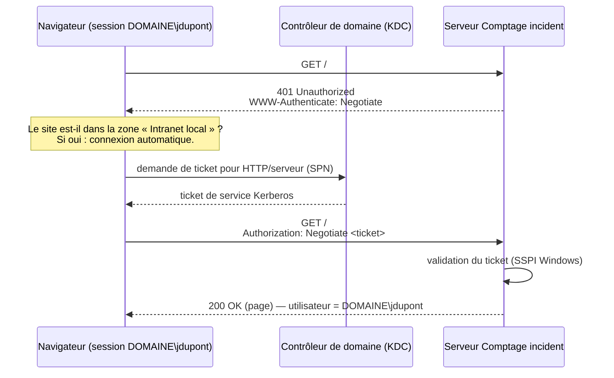

# 03 · Authentification Windows

## Principe

L'utilisateur n'a **rien à saisir** : le navigateur prouve l'identité de la session Windows ouverte grâce au mécanisme **Negotiate**, aussi appelé « authentification Windows intégrée ». Negotiate choisit automatiquement :
- **Kerberos** (préféré) : le navigateur obtient auprès du contrôleur de domaine un *ticket* destiné au serveur, et le présente. Le mot de passe ne circule jamais ;
- **NTLM** (repli) : défi / réponse calculée à partir du mot de passe, qui ne circule pas non plus. Utilisé si Kerberos est impossible (SPN absent, accès par adresse IP, poste hors domaine…).

Dans les deux cas, **l'application ne voit, ne reçoit et ne stocke aucun mot de passe**. Elle obtient seulement le nom du compte authentifié, sous la forme `DOMAINE\login`.

## Déroulement d'une connexion



Ensuite, chaque appel de l'interface à l'API est authentifié de la même façon : `credentials: 'same-origin'` dans `wwwroot/js/app.js`, fonction `api`.

## Où est-ce implémenté ?

### Enregistrement du mécanisme : `Program.cs`, section 3

```csharp
builder.Services.AddAuthentication(NegotiateDefaults.AuthenticationScheme).AddNegotiate();
```
- **Sous IIS** : IIS réalise l'authentification Windows (activée par `web.config` et `Install-IIS.ps1`). Le handler Negotiate détecte que le serveur la gère nativement et **réutilise l'identité fournie par IIS**.
- **Sous Kestrel** (service ou exe) : le handler réalise lui-même l'échange Kerberos/NTLM via l'API SSPI de Windows.

### Règle « tout exige une authentification » : `Program.cs`, section 4

```csharp
builder.Services.AddAuthorization(o => o.FallbackPolicy = o.DefaultPolicy);
```
- La *FallbackPolicy* s'applique à toute requête qui ne déclare pas de règle propre. Aucune route de l'application n'en déclare : il n'existe ni `[AllowAnonymous]` ni `.AllowAnonymous()`.
- `DefaultPolicy` signifie « utilisateur authentifié requis ».
- `app.UseAuthorization()` est placé **avant** `UseStaticFiles()` et `MapApi()`. La page HTML, le JavaScript, le CSS et toute l'API sont donc protégés.

**Comment le vérifier** : chercher `AllowAnonymous` dans `src/`. La seule occurrence attendue est un commentaire de `ApiEndpoints.cs` qui précise qu'il n'y en a pas. Le test `ProductionSecurityTests.Sans_authentification_Windows_tout_est_refuse_avec_un_defi_Negotiate` démarre la vraie application en production et vérifie que `/`, `/index.html`, `/js/app.js` et les routes `/api` renvoient **401** avec un défi `Negotiate`.

### Utilisation de l'identité : `Api/ApiEndpoints.cs`, fonction `UserName`

```csharp
private static string UserName(ClaimsPrincipal user) => user.Identity?.Name ?? "inconnu";
```
L'identité provient exclusivement du `ClaimsPrincipal` établi par l'authentification. Aucune route ne lit un nom d'utilisateur dans la requête : un client ne peut pas se faire passer pour quelqu'un d'autre. Cette identité est enregistrée dans :
- les colonnes `CreatedBy`, `ClosedBy`, `DeletedBy`, `AddedBy` et `RemovedBy` ;
- chaque ligne du journal d'audit.

## Mode développement : pourquoi il ne peut pas être actif en production

Pour développer hors domaine, `Auth/DevAuthenticationHandler.cs` peut simuler un utilisateur. Trois verrous l'empêchent d'exister en production :

| Verrou | Où | Effet |
|---|---|---|
| 1. Condition d'environnement | `Program.cs` : `builder.Environment.IsDevelopment() && DevUser renseigné` | Hors `Development`, c'est `AddNegotiate()` qui est enregistré **à la place** du mode Dev. Les deux ne coexistent jamais |
| 2. Environnement forcé | `web.config` : `ASPNETCORE_ENVIRONMENT=Production` ; un service sans variable vaut aussi `Production` par défaut | L'environnement Development n'est jamais actif sur le serveur |
| 3. Fichier non publié | `ComptageIncident.csproj` : `appsettings.Development.json` avec `CopyToPublishDirectory="Never"` | Même en cas d'erreur de configuration, le fichier qui définit `DevUser` n'est pas présent sur le serveur |

Le test `ProductionSecurityTests` démarre l'application en production **avec** `Auth:DevUser` renseigné **et** l'en-tête `X-Dev-User`, puis vérifie que l'accès est quand même refusé (401).

## Kerberos et SPN

Kerberos identifie le service par son **SPN** : `HTTP/<nom tapé dans le navigateur>`. Ce SPN doit être enregistré sur **le compte qui déchiffre les tickets** :

| Hébergement | Compte qui déchiffre | Accès par le nom du serveur (`http://SRV01`) | Accès par un alias DNS (`http://comptage.entreprise.local`) |
|---|---|---|---|
| IIS (ApplicationPoolIdentity, authentification en mode noyau par défaut) | Compte ordinateur `SRV01$` | Rien à faire (le SPN `HOST/SRV01` couvre `HTTP`) | `setspn -S HTTP/comptage.entreprise.local SRV01` |
| Service LocalSystem / NetworkService | Compte ordinateur `SRV01$` | Rien à faire | `setspn -S HTTP/comptage.entreprise.local SRV01` |
| Service avec compte de domaine `svc-comptage` | `svc-comptage` | `setspn -S HTTP/SRV01 svc-comptage` et `setspn -S HTTP/SRV01.entreprise.local svc-comptage` | `setspn -S HTTP/comptage.entreprise.local svc-comptage` |

- `setspn -S` vérifie les doublons avant d'ajouter : un SPN dupliqué casse Kerberos.
- Sans SPN correct, l'authentification **bascule en NTLM**. C'est fonctionnel, mais moins robuste, et NTLM peut être interdit par la politique de sécurité.
- **Vérification** : sur un poste client, après s'être connecté au site, lancer `klist`. Un ticket `HTTP/<nom>` doit apparaître. S'il est absent, c'est NTLM qui est utilisé.

## Configuration des navigateurs

Les navigateurs n'envoient l'identité Windows **automatiquement** qu'aux sites qu'ils considèrent comme **intranet**.

| Navigateur | Réglage |
|---|---|
| Edge / Chrome (Windows) | Ils utilisent les zones de sécurité Windows. Un nom **sans point** (`http://SRV01`) est en général détecté comme intranet. Un **nom avec des points** (FQDN, alias) doit être ajouté à la zone **Intranet local** |
| Par GPO (recommandé) | *Configuration ordinateur › Modèles d'administration › Composants Windows › Internet Explorer › Panneau de configuration Internet › Page Sécurité › Liste des attributions de sites aux zones* : `http://comptage.entreprise.local` → `1`. Ou la stratégie Edge/Chrome `AuthServerAllowlist` = `comptage.entreprise.local` |
| Firefox | `about:config` → `network.negotiate-auth.trusted-uris` = `comptage.entreprise.local`. Ou la stratégie d'entreprise `Authentication.SPNEGO` |

Si une **fenêtre de saisie identifiant / mot de passe** apparaît, le site n'est pas reconnu comme intranet. L'utilisateur peut quand même saisir ses identifiants Windows, mais la configuration doit être corrigée.

## Limites et points d'attention

- **Proxy inverse / répartiteur de charge** : NTLM et Kerberos sur Kestrel sont liés à la connexion TCP. Ne pas placer de proxy inverse (nginx, etc.) devant le mode autonome. Sous IIS, ARR (Application Request Routing) n'est pas nécessaire et n'est pas recommandé.
- **HTTP/2** : l'authentification Windows ne fonctionne qu'en HTTP/1.1. En HTTPS sous Kestrel, il faut donc `"Protocols": "Http1"` ([08](08-installation-autonome.md#https)). IIS gère ce cas automatiquement.
- **Postes hors domaine** : sans session de domaine, le navigateur demande des identifiants (NTLM). L'accès reste protégé par l'AD.
- **Comptes autorisés** : tout compte authentifié du domaine (et des domaines approuvés) a accès. Pour restreindre l'accès à un groupe, voir [06](06-securite.md#restreindre-laccès-à-un-groupe-ad).
