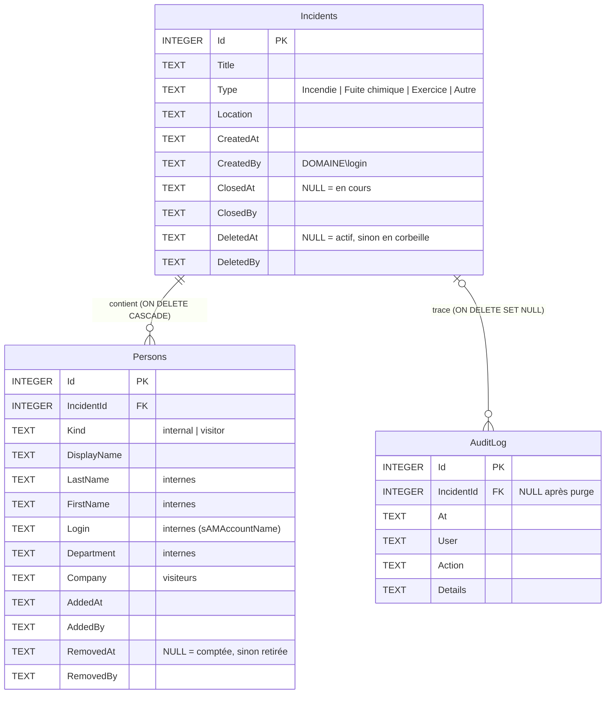
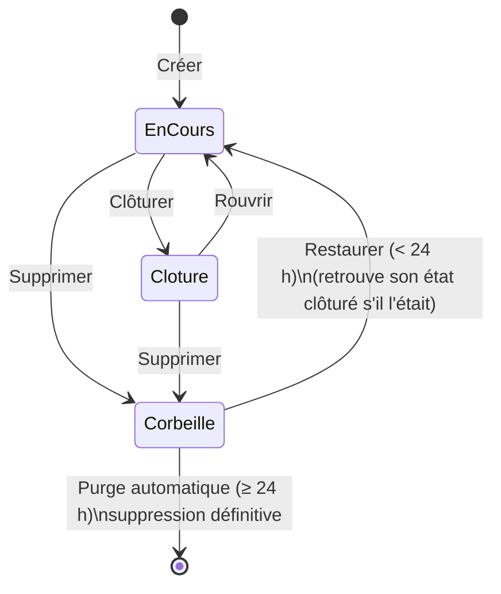
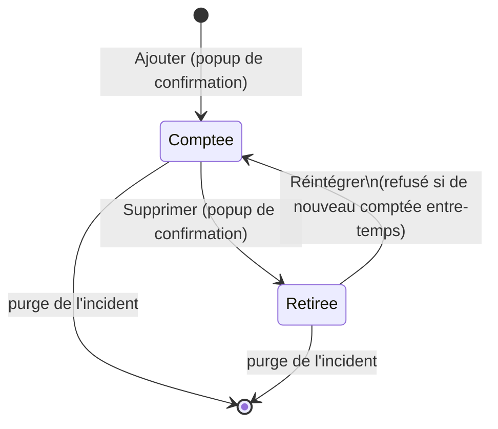

# 05 · Données, corbeille et journal d'audit

## Stockage

Toutes les données sont dans **un seul fichier SQLite** : `App_Data/comptage.db` dans le dossier de l'application. L'emplacement se règle avec `Database:Path`. À côté, deux fichiers techniques temporaires, `comptage.db-wal` et `comptage.db-shm`, appartiennent au mode WAL et font partie de la base.

- Le fichier et les tables sont **créés automatiquement** au premier démarrage (`Data/Database.cs`, `Initialize`). Les instructions sont de la forme `CREATE … IF NOT EXISTS` : une mise à jour de l'application **ne modifie ni ne vide jamais** les données existantes.
- Le compte d'exécution (pool IIS ou service) a le droit **Modifier** sur `App_Data` uniquement. Les scripts d'installation le configurent.
- Les dates sont stockées en **UTC**, au format ISO-8601 (`2026-11-09T22:17:49.785Z`), et affichées en heure locale par le navigateur.

## Schéma

Contraintes d'intégrité, garanties **par la base elle-même** et pas seulement par le code :

| Contrainte | Définition (`Database.cs`) | Garantie |
|---|---|---|
| `CHECK (Kind IN ('internal','visitor'))` | Table `Persons` | Aucune autre catégorie possible |
| Index unique partiel `UX_Persons_ActiveLogin` | `(IncidentId, Login COLLATE NOCASE) WHERE Kind='internal' AND RemovedAt IS NULL` | Un même identifiant Windows ne peut être compté qu'une fois par incident, même en cas de clics simultanés |
| `ON DELETE CASCADE` | `Persons.IncidentId` | La purge d'un incident supprime ses personnes, sans lignes orphelines |
| `ON DELETE SET NULL` | `AuditLog.IncidentId` | La purge d'un incident **conserve** son journal |
| `PRAGMA foreign_keys = ON` | À chaque connexion (`Database.Open`) | Active les deux règles précédentes (SQLite ne les applique pas par défaut) |

## Règles métier

Elles sont énoncées en tête de `Data/IncidentRepository.cs`. **Toutes les écritures passent par cette classe.**

| Règle | Énoncé | Implémentation |
|---|---|---|
| **R1** | Aucune suppression physique déclenchée par un utilisateur | `TrashIncident` fait `UPDATE … SET DeletedAt` ; `RemovePerson` fait `UPDATE … SET RemovedAt`. Aucune route de l'API n'exécute de `DELETE` SQL |
| **R2** | Seule la purge automatique supprime, et seulement après la rétention | `PurgeExpired` (seul `DELETE` de l'application), appelé uniquement par `TrashPurgeService` |
| **R3** | Pas de doublon interne dans un incident | Contrôle dans `AddInternal` et `RestorePerson`, plus l'index unique en base |
| **R4** | Incident clôturé = lecture seule | `CheckWritable`, appelé par `AddInternal`, `AddVisitor`, `RemovePerson` et `RestorePerson` |
| **R5** | Toute action est journalisée dans la même transaction | `Audit(...)` appelé avant `tx.Commit()` dans chaque méthode d'écriture |

**Vérification rapide** : chercher `DELETE` dans `src/`. La seule occurrence SQL est `DELETE FROM Incidents` dans `PurgeExpired`. Les autres occurrences sont `MapDelete` (verbe HTTP), qui appelle des méthodes de mise à jour logique.

## Cycle de vie d'un incident

| État | `ClosedAt` | `DeletedAt` | Visible dans | Modifiable |
|---|---|---|---|---|
| En cours | NULL | NULL | Incidents › En cours | Oui |
| Clôturé | renseigné | NULL | Incidents › Clôturés | Non (409), sauf Rouvrir / Supprimer |
| En corbeille | indifférent | renseigné | Corbeille | Non : l'incident est vu comme inexistant (404) jusqu'à sa restauration |
| Purgé | — | — | Nulle part (trace dans le journal) | — |

## Cycle de vie d'une personne

Les compteurs affichés (internes, visiteurs, total) sont **recalculés à chaque lecture** à partir des personnes dont `RemovedAt` est NULL. Ce sont des sous-requêtes `COUNT(*)` dans `IncidentSelect`. Ils ne peuvent donc jamais être désynchronisés des listes.

## Corbeille et purge

1. « Supprimer l'incident » → popup → `DELETE /api/incidents/{id}` → `TrashIncident` : `DeletedAt = maintenant`.
2. L'incident apparaît dans **Corbeille**, avec la date de suppression définitive : `DeletedAt + RetentionHours`.
3. « Restaurer » → `RestoreIncident` : accepté si `DeletedAt + rétention > maintenant`, sinon **409** « délai dépassé ». Le délai est contrôlé **par le serveur**, indépendamment du passage de la purge.
4. `TrashPurgeService` s'exécute au démarrage puis toutes les `PurgeIntervalMinutes` minutes (15). Il appelle `PurgeExpired`, qui, pour chaque incident expiré :
   - écrit une ligne de journal « Suppression définitive incident » (titre, type, nombre d'internes et de visiteurs) ;
   - supprime l'incident. Ses personnes partent en cascade, et ses lignes de journal sont conservées avec `IncidentId = NULL`.

Garde-fous :
- `RetentionHours` est d'**au moins 1 h**, même si la configuration indique 0 (`IncidentRepository`, constructeur).
- L'intervalle de purge est d'au moins 1 minute.
- Si l'application est arrêtée (pool IIS recyclé, serveur éteint), la purge est **différée**, jamais anticipée.

## Journal d'audit

| Action enregistrée | Auteur | Détail |
|---|---|---|
| Création incident | utilisateur | type — titre (lieu) |
| Ajout interne / Ajout visiteur | utilisateur | nom (identifiant ou société) |
| Retrait interne / Retrait visiteur | utilisateur | nom (identifiant ou société) |
| Réintégration | utilisateur | nom |
| Clôture incident / Réouverture incident | utilisateur | titre |
| Mise en corbeille incident / Restauration incident | utilisateur | titre |
| Suppression définitive incident | `système` | n°, type, titre, effectifs |

- L'auteur est l'identité Windows authentifiée (`DOMAINE\login`), voir [03](03-authentification.md).
- **Aucune fonction** de l'application ne modifie ni ne supprime une ligne du journal : `Audit` ne fait que des `INSERT`. C'est la seule instruction qui touche `AuditLog`.
- Le journal est consultable par incident (bouton **Journal**). Le journal global, y compris les incidents purgés, se lit directement dans la base : voir [09](09-exploitation.md#consulter-le-journal-global).

## Concurrence : plusieurs agents en même temps

- **Écritures** : `conn.BeginTransaction()` de Microsoft.Data.Sqlite ouvre une transaction `BEGIN IMMEDIATE`, qui prend le verrou d'écriture **dès le début**. Deux ajouts simultanés de la même personne sont traités l'un après l'autre : le second voit le premier et reçoit « déjà comptée » (409). L'index unique est une seconde barrière : une violation éventuelle est convertie en 409 (`AddInternal`, `catch SqliteException 19`).
- **Attente** : `busy_timeout = 5000`. Un agent qui écrit pendant l'écriture d'un autre attend jusqu'à 5 s au lieu d'échouer. Une écriture prend quelques millisecondes.
- **Lectures** : le mode **WAL** permet de lire pendant une écriture, sans blocage.
- **Affichage** : chaque écran d'incident se rafraîchit toutes les 5 s (`app.js`, `refresh` / `render`). Si un agent supprime l'incident, les autres sont ramenés à l'accueil avec un message.
- **Saisie en cours non perturbée** : le rafraîchissement ne redessine que l'en-tête, les compteurs et les listes. Le champ de recherche (texte, focus, curseur) et la liste de suggestions ne sont jamais recréés. Le rafraîchissement est suspendu tant qu'une popup est ouverte (saisie d'un visiteur, confirmation). Rien n'est redessiné si les données n'ont pas changé.
- **Suggestions à jour** : une personne comptée par un autre agent pendant que les suggestions sont ouvertes y est grisée « déjà comptée » au rafraîchissement suivant, sans reconstruire la liste (`syncSuggestionState`). L'état est aussi revérifié au clic, et le serveur refuse de toute façon le doublon (409).
- **Ordre des réponses** : chaque rafraîchissement est numéroté ; une réponse plus ancienne que la dernière affichée est ignorée. L'écran ne revient jamais à un état périmé.

## Données personnelles

L'application traite des données personnelles (nom, prénom, service, identifiant, présence lors d'un incident) :
- **Finalité** : sécurité des personnes lors d'un incident.
- **Minimisation** : seuls les attributs listés en [04](04-annuaire-ldap.md#ce-qui-est-lu) sont lus. L'adresse e-mail n'est pas stockée.
- **Durée de conservation** : les incidents sont conservés **jusqu'à leur suppression** par un utilisateur (puis 24 h en corbeille). Il n'y a pas d'effacement automatique des incidents clôturés. Définissez une politique (par exemple « supprimer les exercices après N mois ») et appliquez-la avec le bouton « Supprimer l'incident ».
- **Accès** : utilisateurs authentifiés du domaine ([06](06-securite.md)).
- Pensez à inscrire ce traitement au registre des traitements, selon votre organisation.

## Sauvegarde et restauration

Voir [09 · Exploitation](09-exploitation.md#sauvegarde-et-restauration).
